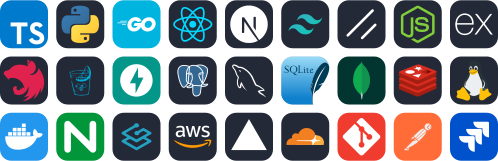

<!--
  How this page is built
  - assets/header.svg, typing.svg, footer.svg, stack.svg and about*.svg are
    generated from profile.config.json by `node scripts/build-profile.mjs assets`.
    Nothing at the top of the page calls a third-party service at view time.
  - The stats, languages, streak and snake cards are rebuilt daily by
    .github/workflows/profile.yml and published to the `output` branch, which
    keeps main free of bot commits. If a refresh fails, yesterday's cards stay.
  - Palette: Tokyo Night. Cards and the About terminal sit on opaque #1A1B26
    plates and the header and footer waves on an opaque #0D1117 base, so the
    page reads the same on GitHub's light and dark themes. The typing line has
    no plate; its colour (#9D7CD8) is chosen to read on both.
-->

  
  

## 👨‍💻 About Me

<!-- Generated from the "about" block of profile.config.json. Phones get the narrow card, without the logo, so the text is not scaled down. -->

  <picture>
    <source media="(max-width: 600px)" srcset="assets/about-narrow.svg" />
    
  </picture>

## 🛠️ Tech Stack

  

## 📊 GitHub Stats

  <!-- align="top": the two cards differ in height by a few pixels, so their tops line up rather than their bottoms. -->
  
  

  

  

## 🏆 Achievements

<!-- Text, not badges: an image in a table cell shrinks to nothing on a phone, text wraps. -->
<table align="center">
  <tr>
    <th align="left">Result</th>
    <th align="left">Competition</th>
  </tr>
  <tr>
    <td>🥇&nbsp;<b>Champion</b></td>
    <td><b>Mammothon</b> · Celestia Hackathon Vietnam</td>
  </tr>
  <tr>
    <td>🥉&nbsp;<b>3rd Place</b></td>
    <td><b>Fintech Blockchain Hackathon</b></td>
  </tr>
  <tr>
    <td>⭐&nbsp;<b>People's Choice</b></td>
    <td><b>AI Innovation Challenge</b></td>
  </tr>
  <tr>
    <td>🎖️&nbsp;<b>Top 20 Finalist</b></td>
    <td><b>Artificial Intelligence Olympiad</b> · OAI Ho Chi Minh City</td>
  </tr>
  <tr>
    <td>🎯&nbsp;<b>Semifinalist</b></td>
    <td><b>Vietnam Blockchain Talent Search</b> · VietChain Talents</td>
  </tr>
  <tr>
    <td>🎗️&nbsp;<b>Consolation Prize</b></td>
    <td><b>Hackathon Pione Dream</b></td>
  </tr>
  <tr>
    <td>🔹&nbsp;<b>Participant</b></td>
    <td><b>Google Developer Groups on Campus</b> · Hackathon Vietnam</td>
  </tr>
  <tr>
    <td>🔹&nbsp;<b>Participant</b></td>
    <td><b>AI+ Unlimited Future</b></td>
  </tr>
  <tr>
    <td>🔹&nbsp;<b>Participant</b></td>
    <td><b>K-Tech AI Hackathon</b></td>
  </tr>
</table>

All in 2025: 6 placements from 9 competitions.

## 📫 Connect

  
  
  
  
  
  

   
  Thanks for stopping by.
    
  
  

